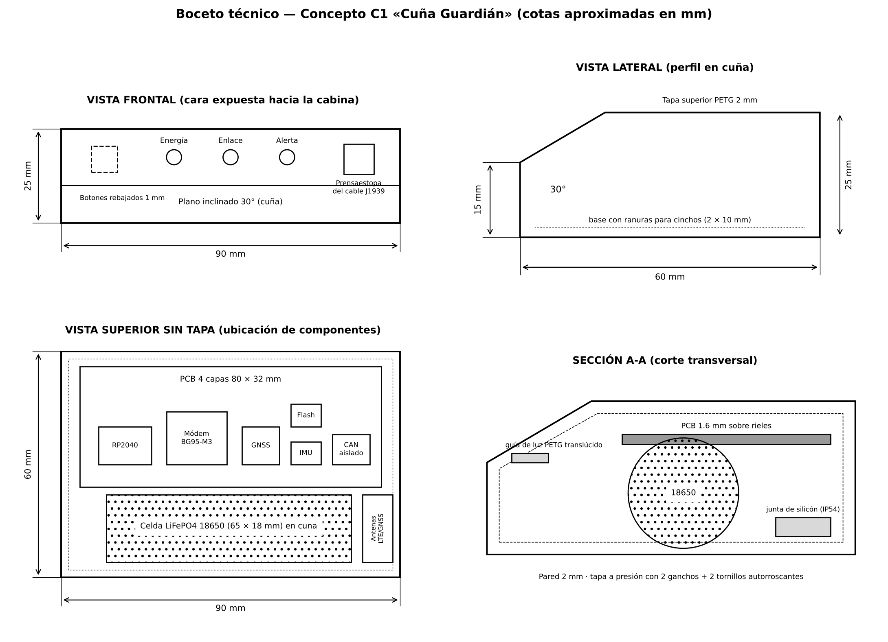

---
hide:
  - navigation
---

# Semana 6 — Generación y selección de concepto de diseño

<strong>Andrik Pérez Luna</strong> · Ingeniería Mecatrónica · Equipo 2: Andrik Pérez Luna, Juan Pablo y Mauro David Sánchez Arenas

## Objetivo de la semana

Dar forma al producto sin caer en la «caja negra de PLA»: generar al menos tres conceptos completos (artefacto, app y página de venta), elegir uno con criterios explícitos en una matriz de Pugh y comprometerlo en un boceto técnico con cotas, materiales y wireframes de la app. El PDS de la Semana 5 fija lo que ya no se discute: dimensiones, IP54, montaje sin perforar y tres LED con dos botones.

---

## Paso 1 — Tabla morfológica

### Prompt 1 (Claude) → Tabla morfológica

Se pidió a Claude, en el rol de diseñador industrial con sesgo hacia opciones construibles con medios universitarios (impresora 3D, CNC básica y componentes disponibles en México), generar siete parámetros con tres variantes fabricables cada uno, indicando la implicación de manufactura. El equipo agregó sus propias variantes (perfil en cuña y cápsula antiagarre) antes de cerrar la tabla.

| Parámetro | Variante A | Variante B | Variante C |
|---|---|---|---|
| **Forma de carcasa** | Caja rectangular compacta (FDM) ■ | Perfil en cuña biselado (FDM/SLA) ● | Cápsula redondeada anti-agarre (FDM/SLA o silicón) ▲ |
| **Instalación / montaje** | Cinta adhesiva automotriz (FDM + adhesivo) ■ | Soporte desmontable con cinchos (FDM) ● | Base atornillada a puntos existentes (FDM + tornillería) ▲ |
| **Indicador de estado** | LED RGB único (electrónica) ■ | Tres LED: energía, enlace, alerta (electrónica) ● | Pantalla OLED pequeña (electrónica) ▲ |
| **Material y acabado** | PLA/PETG mate (FDM) ■ | PETG liso, carcasa cerrada (FDM) ● | ABS/ASA mate (FDM con cámara cerrada) ▲ |
| **Interfaz física** | Un botón multifunción (electrónica) ■ | Dos botones: reinicio y prueba (electrónica) ● | Sin controles; botón de servicio protegido (FDM + electrónica) ▲ |
| **Fuente de energía** | Solo alimentación vehicular (electrónica) ■ | 12/24 V con DC-DC (electrónica) ● | Vehicular + batería LiFePO₄ (electrónica) ●▲ |
| **Protección y ubicación** | Oculto bajo el tablero (FDM) ■ | Compartimento protegido con soporte (FDM) ● | Sellos IP54 cerca de la interfaz (FDM + sello) ▲ |

● C1 Cuña Guardián (elegido) · ■ C2 Caja Discreta (datum) · ▲ C3 Cápsula Lisa

## Paso 2 — Analogías tecnológicas

### Prompt 2 (Claude) → Soluciones de otros sectores

Se pidió buscar productos de sectores distintos que hubieran resuelto el mismo problema de experiencia en los dos parámetros más convencionales:

| Parámetro | Analogía (sector) | Lógica que se trasplanta |
|---|---|---|
| Indicador de estado | Panel de advertencias de avión (aeronáutica) | «Una luz, un significado»: tres LED separados en lugar de un RGB |
| Indicador de estado | Detector de humo (seguridad doméstica) | Destello tenue de «vivo» + botón de autoprueba |
| Protección | Cámara domo antivandalismo (seguridad urbana) | Superficie lisa sin aristas de agarre |
| Protección | Caja negra de vuelo (aeronáutica) | Lo importante es que el registro sobreviva, no esconder el aparato |

**Variante nueva para la tabla:** cuña con aristas redondeadas en la cara expuesta (FDM con chaflanes a 45°).

## Paso 3 — Los tres conceptos de diseño

### Prompt 3 (Claude) → Conceptos completos de artefacto, app y landing

Con la tabla enriquecida, el equipo indicó la combinación de cada concepto y Claude desarrolló instalación, uso cotidiano, principios de diseño activos, app y página de venta.

| | C1 · Cuña Guardián | C2 · Caja Discreta (datum) | C3 · Cápsula Lisa |
|---|---|---|---|
| Forma | Cuña biselada a 30° | Caja rectangular | Cápsula redondeada |
| Montaje | Soporte con 2 cinchos | Cinta adhesiva | Base atornillada |
| Indicador | 3 LED | LED RGB | OLED |
| Material | PETG liso | PLA/PETG mate | ABS/ASA |
| Energía | Vehicular + LiFePO₄ | Solo vehicular | Vehicular + LiFePO₄ |
| Analogía | Caja negra + panel de avión | Etiqueta rastreadora adhesiva | Domo antivandalismo |
| Implicación de manufactura | Imprimir sin soportes con el plano a 30° | La más simple | ABS se deforma; requiere soportes |
| Headline de landing | «Cuando el jammer apaga todo, Nervik sigue contando lo que pasó» | «Rastreo anti-jammer que se instala en 5 minutos» | «Imposible de arrancar, imposible de ignorar» |

**Instalación de C1 en lenguaje del usuario:** 1) escanear el QR de la caja; 2) conectar el cable al conector verde de 9 pines; 3) colocar la cuña con la cara inclinada hacia abajo y apretar los cinchos; 4) esperar la prueba de 30 s; 5) confirmar los tres LED fijos.

## Paso 4 — Matriz de Pugh

### Prompt 5 (Claude) → Selección con criterios ponderados

Se pidieron entre 8 y 10 criterios con peso explícito: al menos 3 de deseabilidad y 3 de factibilidad, con la deseabilidad sumando como mínimo el 40%. El resultado fue de 9 criterios, con 45% de peso en deseabilidad. Datum: C2.

| Criterio (peso) | Tipo | C1 Cuña Guardián | C2 Caja Discreta | C3 Cápsula Lisa |
|---|---|:---:|:---:|:---:|
| Instalación sin herramientas (15%) | Deseab. | S | datum | − |
| Estado legible sin app (12%) | Deseab. | + | datum | + |
| Resistencia a manipulación (13%) | Deseab. | + | datum | + |
| Confianza del acabado (5%) | Deseab. | S | datum | + |
| Costo por unidad a 10 u (15%) | Factib. | − | datum | − |
| Complejidad de ensamble (10%) | Factib. | − | datum | − |
| Compatible con FDM y JLCPCB (10%) | Factib. | S | datum | − |
| IP54 y 60 °C en cabina (10%) | Factib. | + | datum | + |
| Tiempo de prototipo (10%) | Factib. | S | datum | − |
| **Puntuación ponderada** | | **+10** | **0** | **−20** |

Deseabilidad = 45% del peso total (mínimo exigido 40%). + suma el peso, − lo resta, S = igual al datum.

!!! tip "Ganador: C1 Cuña Guardián (+10)"
    Gana en legibilidad, resistencia a manipulación y desempeño a 60 °C, sin perder la instalación sin herramientas ni la compatibilidad con FDM, que es donde C3 cae (−20).

    **Riesgo:** el costo por unidad (15% del peso); se mitigará en la revisión DFM.

    **Iteración:** adoptar de C3 las aristas redondeadas y la junta de silicón IP54.

## Paso 5 — Boceto técnico del concepto elegido

### Prompt 6 (Claude) → Crítica y boceto técnico

Se dibujó el boceto digital con tres vistas y una sección transversal, con cotas aproximadas, materiales por parte y ubicación de componentes. El equipo debe complementarlo con el boceto a mano en papel milimétrico.

<figure class="figure-card">
  
  <figcaption>Boceto técnico — Concepto C1 «Cuña Guardián» (cotas aproximadas en mm)</figcaption>
</figure>

- **Dimensiones:** 90 × 60 × 25 mm; plano inclinado a 30° de 25 a 15 mm.
- **Materiales:** PETG negro de 2 mm de pared; guías de luz de PETG translúcido; junta de silicón IP54; cinchos de nailon.
- **Componentes:** PCB de 4 capas de 80 × 32 mm sobre rieles; celda 18650 en cuna inferior; antenas lejos de la celda; prensaestopa lateral para el cable J1939.
- **Ensamble:** tapa con 2 ganchos + 2 tornillos autorroscantes; se abre para cambiar la batería.

## Paso 6 — Wireframes de la app

  
Flota · 24 unidades

  
Todo en orden 24 de 24 protegidas

  
Mapa: unidades en ruta (puntos)

  
TR-0417 · México–Puebla · ● protegido

  
TR-0388 · Puebla–Veracruz · ● protegido

  
TR-0402 · En patio · ● sin viaje

  
Ver unidad

ESTADO NORMAL

  
Flota · 1 alerta

  
NIVEL 3 · TR-0417 sin señal desde 22:45

  
Última posición válida 22:44 Km 162 México–Puebla

  
Señales: GNSS 0 satélites · LTE perdido

  
Unidad en movimiento sin posición

  
Bitácora firmada: íntegra

  
Activar protocolo

ESTADO DE ALERTA

!!! note "Omisión deliberada"
    No hay gráficas de RPM o combustible, datos crudos del bus ni botón de paro de motor. La pantalla responde una sola pregunta: **¿alguna unidad está siendo atacada ahora?**

### Flujo de instalación

  
Instalar · paso 1 de 3

  
Escanea el código QR de la caja

  
[ cámara ]

  
Unidad: TR-0417 (elegir de lista)

  
Siguiente

PASO 1

  
Instalar · paso 2 de 3

  
Conecta el cable al puerto de 9 pines

  
Ilustración: conector verde redondo bajo el tablero

  
Fija la cuña con los 2 cinchos

  
Ya está conectado

PASO 2

  
Instalar · paso 3 de 3

  
Prueba automática (30 s)

  
✓ Energía del vehículo

  
✓ Datos del bus J1939

  
✓ Satélites GNSS

  
… Red celular

  
Terminar

PASO 3

## Paso 7 — Defensa de concepto (3 minutos)

1. **Minuto 1:** una cuña de 9 × 6 cm que se conecta al puerto de 9 pines y se fija con dos cinchos; tres luces fijas indican protección.
2. **Minuto 2:** gana a la caja con adhesivo en legibilidad, resistencia a tirones y temperatura; a la cápsula, porque esta necesita desarmador y ABS.
3. **Minuto 3:** el riesgo es el costo por unidad; se reduce quitando insertos y probando con un fixture de pogo pins.

## Conclusión de la semana

Generar tres conceptos antes de elegir evitó que el diseño se decidiera por gusto: la cápsula era la más atractiva, pero la matriz mostró que no se puede fabricar bien con los medios del equipo. La cuña ganó porque su forma tiene una función (desviar golpes y proteger la conexión), no por estética. La disciplina de la omisión en la app (mostrar solo lo que responde «¿están atacando una unidad?») es tan importante como el hardware.
