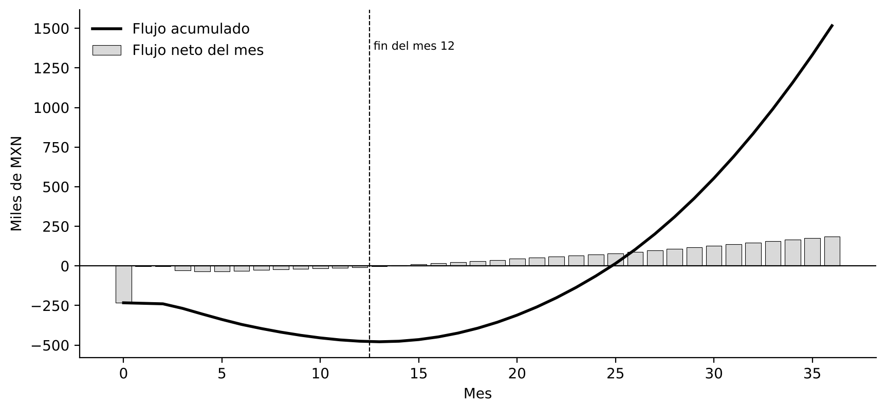

---
hide:
  - navigation
---

# Semana 7 — Viabilidad técnica y económica

<strong>Andrik Pérez Luna</strong> · Ingeniería Mecatrónica · Equipo 2: Andrik Pérez Luna, Juan Pablo y Mauro David Sánchez Arenas

## Objetivo de la semana

Responder la pregunta que más equipos evitan: **¿el negocio cierra?** La pertinencia se respondió en las semanas 2 a 4 y la factibilidad en la 5 y la 6. Esta semana mide la viabilidad: cuánto cuesta realmente fabricar Nervik, cuánto cuesta la IA, a qué precio vender, cuántas unidades hacen falta para el punto de equilibrio y si el VPN es positivo. Todo se construyó en una hoja de cálculo con fórmulas visibles.

---

## Bloque 1 — Pertinencia, factibilidad y viabilidad

- **Económica:** se analiza en los bloques siguientes.
- **Operativa:** con PCBA de JLCPCB y un fixture de prueba, el ensamble es de unos 15 min por unidad; manejable para 100 unidades al año.
- **Legal:** el dispositivo no emite interferencia ni actúa sobre el vehículo; requiere un módem homologado por el IFT, cumplir la ley de protección de datos personales y, si el registro se usará como evidencia, criterios compatibles con la NOM-151.

## Bloque 2 — Modelo de ingresos

### Prompt (Perplexity) → Benchmarking de modelos de ingresos

Se pidió investigar tres empresas con oferta similar: quién paga, cuándo, rango de precio, fricción y otros pagadores posibles.

| Empresa | Modelo de ingresos | Precio | Fricción / otros pagadores |
|---|---|---|---|
| Motive | Suscripción por vehículo al mes, hardware incluido, contrato anual | ≈ US$35/mes | Precio oculto, contrato de 12 meses / aseguradoras, brokers |
| Geotab | Hardware vendido o prestado + SaaS; contratos de 3 años | US$80–120 + US$30–40/mes | Configuración compleja / integradores |
| Detecta Security (custodia) | Por servicio o ruta | $8,000–45,000 por ruta | Costo por viaje / la aseguradora puede exigirla |

**Modelo predominante:** hardware + suscripción por vehículo al mes. **Stakeholder no cobrado:** la aseguradora de carga.

!!! tip "Modelo elegido para Nervik"
    Hardware a **$1,800** instalado + suscripción de **$300 al mes** (app, conectividad, expedientes y reporte para la aseguradora). **Desafío de diseño:** el expediente firmado solo existe dentro de la suscripción, para que su valor sea visible.

## Bloque 3 — Costos

### BOM cotizado

Se cotizó la arquitectura del PDS, no la del BOM preliminar, en fuentes reales, el 30 de octubre de 2026, con un tipo de cambio de $18.65 (FIX de Banxico del 27 de octubre).

| Componente | Especificación | USD a 100 u | Fuente | Estado |
|---|---|---:|---|:---:|
| Microcontrolador | RP2040, Cortex-M0+ a 133 MHz, 264 kB | 0.76 | LCSC C2040 | ✅ |
| Controlador CAN | MCP2515 | 1.05 | LCSC C12368 | ✅ |
| Transceptor CAN aislado | ISO1042 | 1.60 | LCSC C2672259 | ✅ |
| IMU | LSM6DSOX ±16 g | 1.66 | LCSC C481766 | ✅ |
| Módem | Quectel BG95-M3 (LTE-M/NB + 2G) | 19.91 | Mouser vía Findchips | ✅ |
| GNSS | Quectel LC76G | 5.48 | Avnet | ✅ |
| Cable J1939 | Y Deutsch de 9 pines | 7.68 | Alibaba (MOQ 100) | ✅ |
| SIM IoT | 1NCE, 10 años, 500 MB | 16.00 | Lista de precios 1NCE (oct. 2026) | ✅ |
| Resto | Flash, energía, batería, LED, pasivos, antenas | ≈ 9.98 | LCSC / proveedores | 🟡 Estimado |

BOM puesto en México: $1,375
PCB + PCBA + envío: $73
Carcasa: $45
Ensamble y prueba: $30
Overhead 15%: $228
Contingencias 25% BOM: $344

MXN por unidad a 100 unidades — total $2,095

- Componentes: **$754** a 100 piezas. **Excede en $104 el requisito C-01 del PDS**; el módem es el 49% del costo.
- Costo unitario del hardware: **$2,095 a 100 unidades** y **$2,662 a 10 unidades**.
- Riesgo: el BG95-M3 tiene hasta 16 semanas de entrega de fábrica, contra el límite de 8 semanas del requisito C-05.

### Costos D/F/S

Se llenó la plantilla del profesor (CREAR / DISTRIBUIR). Los **D** son pocos y conectados con la propuesta: el modelo TinyML, el sensado multiseñal y la bitácora firmada. El módem, que es el mayor costo, es **F**: la palanca está ahí sin tocar el diferencial. Son **S** la PCB, la nube, la tarifa de IA, el cable y la SIM.

### Costo de la IA

Se escribió el **prompt real del producto** (rol del sistema, telemetría en JSON, eventos del modelo, historial del tramo, verificación HMAC; 2,168 caracteres) y se estimaron sus tokens: unos **900 de entrada** y **600 de salida**. Precio de Claude Haiku 5.5: US$0.10 por millón de tokens de entrada y US$0.50 por millón de salida.

!!! tip "Fórmula"
    1.34 llamadas/día × (900 × 0.10 + 600 × 0.50) / 10⁶ × 30 = US$0.0157 al mes, es decir **$0.29 MXN por unidad**. Con 100 usuarios son $29 al mes; la IA es el 0.1% de la suscripción. La decisión de la Semana 5 (edge) fue también la decisión económica correcta.

### Ciclos de aprendizaje

Un ciclo cuesta $25,958 directos, $29,851 con 15% de indirectos. Con 30% de contingencia:

| Escenario | Ciclos | Costo total |
|---|:---:|---:|
| Mínimo | 3 | $116,420 |
| **Promedio (presupuestado)** | **6** | **$232,840** |
| Máximo | 8 | $310,454 |

## Bloque 4 — Ejercicios 4 a 9

| Ejercicio | Planteamiento | Resultado | Decisión |
|---|---|---|---|
| 4 | $250,000; $60,000 × 6 años; 11% | Factor 4.2305 → VPN **+$3,832** | Aceptar (por poco) |
| 5 | $50,000; flujos de 7.5k, 12k, 20k y 25k; 4% | VPN **+$7,456** | Viable |
| 6 | $1,000,000; flujos de 300k, 350k, 375k y 300k + 150k de salvamento; 10% | VPN **+$151,083** | Viable |
| 7 | X frente a Y, $50,000, 8% | X **+$14,427** · Y **+$12,128** | Se prefiere X |
| 8 | Sensibilidad de X | ver gráfica | Cambia entre 20% y 25% (TIR ≈ 23.4%) |
| 9 | Global Solutions, r₁ = 14%, r₂ = 22% | VPN₁ +40,686 · VPN₂ −36,714 → **TIR ≈ 18.2%** | Viable (> 14%) |

### Sensibilidad del proyecto X (ejercicio 8)

<svg viewBox="0 0 600 300" role="img" aria-label="Sensibilidad del VPN del proyecto X frente a la tasa de descuento">
  <line x1="60" y1="40" x2="60" y2="260" stroke="#444"/>
  <line x1="60" y1="212.2" x2="560" y2="212.2" stroke="#666" stroke-dasharray="3,3"/>
  <line x1="60" y1="260" x2="560" y2="260" stroke="#444"/>
  <text x="52" y="78" text-anchor="end" font-size="10" fill="#ccc">18,000</text>
  <text x="52" y="216" text-anchor="end" font-size="10" fill="#ccc">0</text>
  <text x="52" y="256" text-anchor="end" font-size="10" fill="#ccc">−5,000</text>
  <g font-size="11" fill="#ccc" text-anchor="middle">
    <text x="60" y="278">5%</text>
    <text x="160" y="278">10%</text>
    <text x="260" y="278">15%</text>
    <text x="360" y="278">20%</text>
    <text x="460" y="278">25%</text>
    <text x="560" y="278">30%</text>
  </g>
  <text x="310" y="296" text-anchor="middle" font-size="12" fill="#ccc">Tasa de descuento (%)</text>
  <text x="20" y="150" text-anchor="middle" font-size="12" fill="#ccc" transform="rotate(-90 20 150)">VPN del proyecto X (USD)</text>
  <polyline points="120,74.1 260,144.4 360,186.7 460,223.7" fill="none" stroke="#E3000F" stroke-width="3"/>
  <g fill="#E3000F">
    <circle cx="120" cy="74.1" r="5"/>
    <circle cx="260" cy="144.4" r="5"/>
    <circle cx="360" cy="186.7" r="5"/>
    <circle cx="460" cy="223.7" r="5"/>
  </g>
  <g font-size="11" fill="#fff" font-weight="700">
    <text x="130" y="68">14,427</text>
    <text x="270" y="138">7,081</text>
    <text x="370" y="180">2,662</text>
    <text x="400" y="240">−1,200</text>
  </g>
</svg>

El VPN cruza cero entre 20% y 25% — TIR aproximada de 23.4%.

## Bloque 5 — Modelo económico

### Prompt (Claude) → Modelo económico

Se entregaron el producto, la propuesta de valor, el modelo de ingresos, el BOM cotizado, el costo de la IA, la nube y el volumen objetivo, y se pidieron los 5 pasos del formato: costo unitario, precio (cost-plus y value-based), punto de equilibrio, flujo a 12 meses y VPN al 15%.

| Concepto | Resultado |
|---|---|
| Costo unitario | $2,662 (10 u) · $2,095 (100 u) |
| Cost-plus (40%) | $2,934 de hardware · piso de suscripción de $83 al mes |
| Value-based | Techo de $454 al mes si la aseguradora evita 1 custodia al año por unidad; **$37 al mes sin ese supuesto** |
| **Precio recomendado** | **$1,800 + $300 al mes** |
| Punto de equilibrio | 154 unidades-año; 123 suscripciones activas para cubrir la operación |
| Flujo a 12 meses | Ningún mes positivo; acumulado mínimo de −$475,271 |
| **VPN a 12 meses (15%)** | **−$458,058 → inviable a 12 meses** |
| VPN a 36 meses | +$962,058; flujo positivo desde el mes 14; recuperación en el mes 25 |

<figure class="figure-card">
  
  <figcaption>Flujo neto mensual (barras) y flujo acumulado (línea) a 36 meses — recuperación alrededor del mes 25</figcaption>
</figure>

!!! danger "Alertas"
    El BOM incumple C-01; el precio de $300 depende de que la aseguradora reconozca la evidencia (hipótesis H3); hacen falta unos $480,000 de financiamiento antes del mes 14.

!!! tip "Palancas"
    Cobrar a la aseguradora o al broker por unidad equipada; usar el GNSS integrado del BG95 (−$102 por unidad); dos flotas ancla con suscripción prepagada.

## Conclusión de la semana

Los números confirmaron dos cosas incómodas y útiles: Nervik no cierra en un año, porque es un negocio de suscripción que se paga en tres, y su precio depende menos del costo que de una sola hipótesis de mercado (que la aseguradora acepte la evidencia y evite custodias). La IA, que parecía el riesgo de costo, resultó irrelevante gracias a la arquitectura en el borde; el verdadero costo está en el módem celular. La entrevista con un broker o suscriptor de seguros es ahora la tarea más importante del proyecto.
